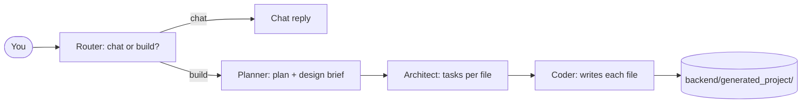

# Zuno

Zuno is an AI website builder. Describe a website in plain words, and Zuno plans it, breaks it into tasks, and writes the code — file by file.

## How it works

You send a prompt. The router decides if it is a chat or a build. For a build, the planner makes a project plan, the architect splits it into tasks (one per file), and the coder writes each file.



## Run it locally

Backend (from the repo root):

```sh
python -m venv .venv
source .venv/bin/activate
python -m pip install -r backend/requirements.txt
cp .env.example .env
```

Put your `GROQ_API_KEY` in `.env`, then:

```sh
uvicorn app.main:app --app-dir backend --reload
```

Frontend (in another terminal):

```sh
cd frontend
npm install
npm run dev
```

Open http://localhost:5173, describe a website, and watch it build. API docs: http://127.0.0.1:8000/docs.

## API

- `POST /api/chat` with `{"prompt": "Build a portfolio website"}` runs the agent.
- `GET /api/files` lists generated files. `GET /api/files/{path}` returns one file.
- `GET /preview` serves the generated site. `GET /api/health` is the health check.

Generated files live in `backend/generated_project/`.

## What's next

- Validator: check every file exists and parses before saying "build complete".
- Evals: measure build success rate, time, and cost on fixed prompts.
- Tests: automated checks for the file tools and the validator.
- Build history: save past builds so they survive a restart.
